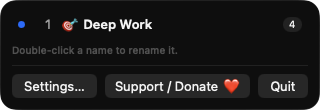
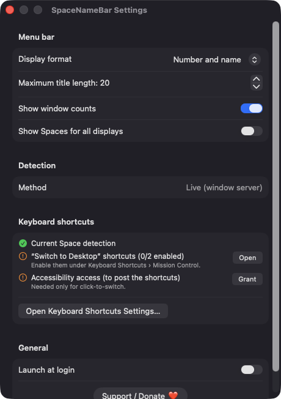
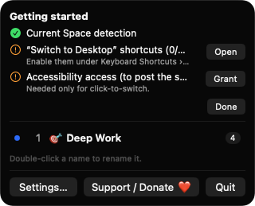

# SpaceNameBar

**🌐 Website:** [turhe123.github.io/space-name-bar](https://turhe123.github.io/space-name-bar/)

Name your virtual desktops and see the current Space name in the menu bar, with click-to-switch.

> 🆓 A free, open-source **Deskspace alternative** for macOS 14+. Native Swift, no accounts, no subscriptions, MIT licensed.


## Why

macOS only calls your Spaces "Desktop 1", "Desktop 2" and so on, and gives no visible indicator of which one you are on. SpaceNameBar is a free, open-source, 100% native, backend-free alternative to paid utilities in the *Menu Bar Utility* category (inspired by Deskspace, $6 one-time). It has no accounts, no servers, no analytics and no network access. Names are stored locally in your user defaults.

## Features

- **Current Space in the menu bar**: shows the Space number, its custom name, or both (Number and name / Number only / Name only).
- **Custom names and emoji**: double-click a Space in the dropdown to rename it and give it an optional emoji prefix. Names are saved per Space UUID, so reordering Spaces in Mission Control keeps names correct.
- **Click-to-switch**: click a row to jump to that Space. This works by posting your "Switch to Desktop N" keyboard shortcuts (the configured shortcut is read from system settings, with the macOS defaults as fallback).
- **Full-screen Spaces**: full-screen app Spaces are labeled with the app's name, and clicking one activates that app.
- **Window counts**: an optional badge on each row shows how many app windows live on that Space (windows that appear on every Space are not counted).
- **Multiple displays**: shows the Spaces of the menu bar display by default, with a setting to list every display.
- **Settings**: display format, maximum title length (5–40), window counts toggle, all-displays toggle, a shortcuts checklist with a button that opens Keyboard Shortcuts settings, and launch at login.
- **Getting-started checklist**: on first launch it shows whether Space detection, the Switch to Desktop shortcuts and Accessibility access are in place.
- **Graceful fallback**: if the window-server lookup is unavailable on a future macOS, it falls back to the Dock's saved layout (which may lag behind, with window counts disabled) and says so in Settings.
- Handles up to 16 Spaces, and debounces refreshes during the Space-switch animation.

## Screenshots

<p align="center"></p>

<p align="center"><em>The SpaceNameBar dropdown lists your Spaces with custom names and emoji, marks the current one, and shows how many windows each holds.</em></p>

<p align="center"></p>

<p align="center"><em>Settings let you choose the menu bar format, title length, window counts, multi-display listing, shortcut checks and launch at login.</em></p>

<p align="center"></p>

<p align="center"><em>On first launch, a getting-started checklist confirms Space detection and helps enable the Switch to Desktop shortcuts and Accessibility access.</em></p>

## Install

1. Download `SpaceNameBar-macOS.zip` from the [latest release](https://github.com/turhe123/space-name-bar/releases/latest).
2. Unzip it and move `SpaceNameBar.app` to `/Applications`.
3. Because the app is open source and not notarized, clear the quarantine flag:

   ```bash
   xattr -cr /Applications/SpaceNameBar.app
   ```

4. Right-click the app and choose **Open** the first time.

For click-to-switch, enable the "Switch to Desktop N" shortcuts under System Settings › Keyboard › Keyboard Shortcuts › Mission Control, and grant Accessibility access (see below).

## Build from source

Requires Xcode with a macOS 14+ SDK.

```bash
brew install xcodegen
xcodegen generate
xcodebuild -project SpaceNameBar.xcodeproj -scheme SpaceNameBar -configuration Release -derivedDataPath ./build build
```

The app is produced at `build/Build/Products/Release/SpaceNameBar.app`.

## Permissions

- **Accessibility** (only for click-to-switch): needed to post the Control+number keyboard shortcuts that make macOS change Space. The app asks for it when you first click a Space or press Grant in the checklist. Without it, the menu bar name, renaming and everything else still work.
- **Keyboard shortcuts**: not a permission, but click-to-switch needs the "Switch to Desktop N" shortcuts enabled in System Settings. The app only reads the shortcut settings and never changes them.
- **Launch at login** (optional): registered through the system login items API when you turn it on.

SpaceNameBar does **not** request Screen Recording or Microphone access, and it makes no network connections. Window counts use only window bounds and owner information, not window contents or titles.

It also reads the window server's Space information through system symbols loaded at runtime. These are not public APIs, so a future macOS update could change them (see the fallback mode above).

## Built with AI

SpaceNameBar was written by [Claude Code](https://claude.com/claude-code) inside an automated pipeline, from a plain-English spec. No code, binaries or assets from any commercial app were used; it is a clean-room reimplementation of a feature set, not a copy.

What that means in practice:

- The full source is in this repo under the MIT license. Read it before you run it.
- No network calls, no analytics, no third-party dependencies. Only Apple frameworks.
- Ad-hoc signed and not notarized, which is why Gatekeeper warns on first launch.
- It has had less human review than a hand-written app. Bug reports and pull requests are welcome.

## Support ❤️

SpaceNameBar is free and always will be. If it's useful to you, you can support its development:

[Support Or (Leo) Davidai ❤️](https://ko-fi.com/leodavidai)

## More free Mac apps

SpaceNameBar is one of a growing collection of [free, open-source Mac utilities](https://github.com/turhe123/mac-apps) built the same way: native Swift, no accounts, no telemetry. Browse the full gallery at [turhe123.github.io/mac-apps](https://turhe123.github.io/mac-apps/).

Prefer something that runs in the browser? The same pipeline builds [free, private web tools](https://turhe123.github.io/web-tools/): PDF, image, developer, data and audio tools, nothing uploaded.

## License

MIT © Or Davidai Bachar
